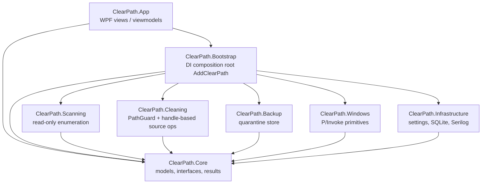
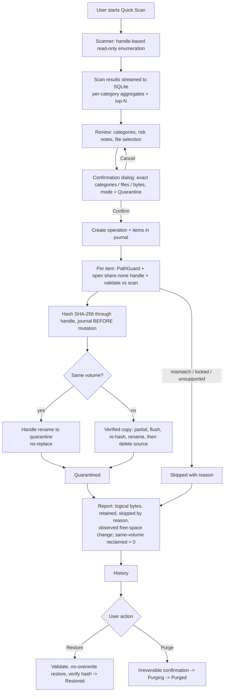
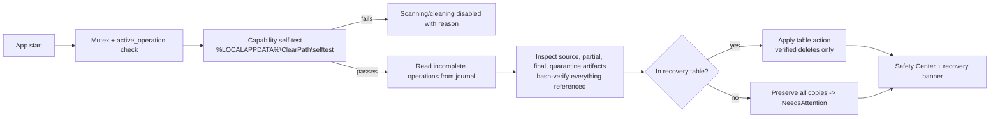

# 05 - Architecture

## 1. Project dependency graph

Implementation projects depend on **Core only**. Core holds models, interfaces and result types. Bootstrap is the single composition root; App holds only views and view models.

Rules:
- App references only Core + Bootstrap.
- Scanning, Cleaning, Backup, Windows, Infrastructure reference only Core.
- Cleaning and Backup interact solely through Core interfaces (`IQuarantineStore`); no project reference between them.
- Enforced by architecture tests (NetArchTest + IL call scan), see [12](12-test-strategy.md).

## 2. Project responsibilities

| Project | Responsibility |
|---|---|
| Core | Models, interfaces (`IScanner`, `ICleaner`, `IQuarantineStore`, `IOperationJournal`, `ISystemMetrics`, `IVolumeInfo`, `IRecycleBinInfo`, `IPrivilegeInfo`, `IPathGuard`, `ISettingsStore`, `IHistoryRepository`), result types |
| Scanning | Read-only handle-based enumeration; no mutation calls |
| Cleaning | PathGuard; handle-based operations on original source files; space accounting |
| Backup | Quarantine store, manifests, verified copies; writes only under the quarantine root via `QuarantineRootGuard` |
| Windows | P/Invoke: metrics, volumes, known folders, Recycle Bin query, handle-operation primitives |
| Infrastructure | Settings JSON, SQLite journal/history, Serilog; touches only its own data dir |
| Bootstrap | `AddClearPath()` DI registration |
| App | WPF views and view models only |

## 3. Mutation ownership

| Actor | May mutate | May not mutate |
|---|---|---|
| **Cleaning** | Original user source files: move to quarantine, restore, permanent delete (sole authority) | Anything outside approved rule roots / restore roots |
| **Backup** | Only inside the configured quarantine root: quarantine files, manifests, partial copies, purge of quarantine items; every write through `QuarantineRootGuard` | Original source files |
| **Infrastructure** | Its own data dir only: settings, DB, logs | User files |
| **App, Core, Scanning** | Nothing on the filesystem | - |
| **Windows** | Provides handle primitives, invoked only by Cleaning / Backup | Acts on no path by itself |

Additional constraints:
- Prohibited for source files and quarantine artifacts: `File.Delete/Move`, `Directory.Delete/Move`, `MoveFileEx`, any path-based fallback. Unsupported operation => Skipped("unsupported operation: ...").
- Concurrency: single-instance mutex plus an `active_operation` row in SQLite; a second operation is rejected.
- Manifests are advisory; SQLite is the sole source of truth.

## 4. Runtime flow

## 5. Startup recovery flow

## 6. Concurrency and threading

- Scan: bounded parallelism (`Parallel.ForEachAsync`, MaxDOP = min(4, cores)) across rule roots / top-level directories; per-directory and per-file try/catch; cancellation checked per entry.
- Memory: per-category aggregates + top-N in memory; the full list is paged from SQLite.
- Cleaning: sequential per item inside one operation; state written before and after every filesystem step.
- UI: dashboard polling (2 s) only while visible; filesystem work never on the UI thread.

## 7. Design principles

1. Never trust paths: validate, open a handle, then act through that handle.
2. Metadata (ID, size, mtime) detects change; the SHA-256 is the integrity proof.
3. The rename/delete itself is the guarantee (no-replace), never a prior existence check.
4. One verified copy of user data always exists, except in an explicitly confirmed purge.
5. Unknown state => preserve everything and ask.
