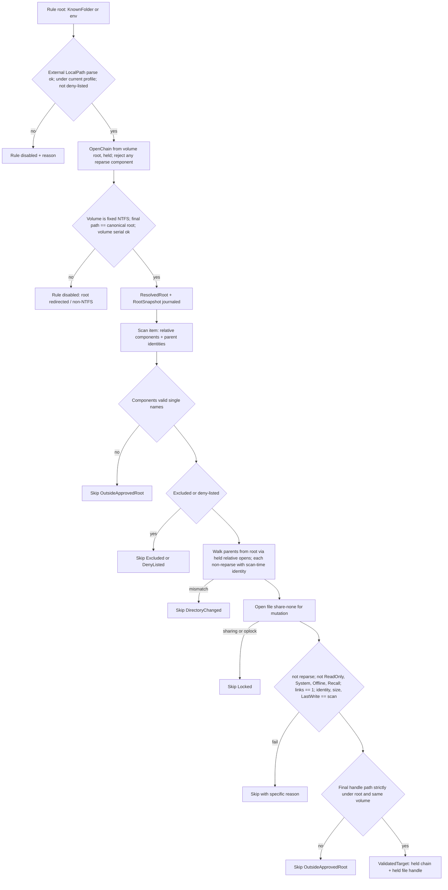

# 15 – Safety Design Package (M2), revision 2

Status: **for user approval.** Revision 1 was reviewed by an independent Opus reviewer (verdict: *Approve with required changes*, no Critical findings). Revision 2 resolves every required change; the mapping is in §12. No Cleaning/Backup code is written until you approve this document.

Contents: 1 Capability evidence · 2 Plan amendments and deviations needing sign-off · 3 Core interfaces · 4 Journal schema v2 · 5 Handle-operation API · 6 PathGuard flow · 7 State machines · 8 Crash-recovery and in-process reconciliation · 9 Metadata and cross-volume policy · 10 Adversarial test plan · 11 Cross-cutting decisions · 12 Review findings → resolution · Appendix A: deferred cross-volume design

---

## 1. Capability evidence

Probed 2026-11-05, **Windows 11 25H2 build 26200, NTFS, non-admin, Medium integrity**, in throwaway sandboxes (volume A = C:, the profile/quarantine volume; volume B = D:), deleted afterwards. Raw results: [m2-probe-results.txt](m2-probe-results.txt); source: `tools/capability-probe/Program.cs`. Windows 10 22H2 not available: the startup self-test (§11.7) repeats the load-bearing probes on the quarantine volume and disables any feature whose probe fails.

| ID | Probe (volume) | Observed | Used for |
|---|---|---|---|
| P1/P2/P3 | Handle rename onto existing name: Ex Flags=0 / non-Ex ReplaceIfExists=FALSE / Ex POSIX (A) | All `ERROR_ALREADY_EXISTS`, target untouched | No-overwrite; POSIX not used |
| P4a | `SetFileInformationByHandle` rename with `RootDirectory` (A) | `ERROR_INVALID_PARAMETER` | Win32 wrapper unusable for relative targets |
| P4b/P4d | `NtSetInformationFile(FileRenameInformationEx)`, RootDirectory = dir handle, relative name; new / existing name (A) | Moved into that dir / `STATUS_OBJECT_NAME_COLLISION`, existing untouched | **All renames** (§5.4) |
| P5 | Handle rename to volume B | `ERROR_NOT_SAME_DEVICE` | Cross-volume detection |
| P6/P7 | Delete disposition (Ex DELETE / non-Ex) with another share-delete handle open (A) | Call succeeds; entry visible until the other handle closes | Verify absence after close (§5.6) |
| P8a/b | Set all four times incl. ChangeTime, reopen (B) | All equal | ChangeTime restorable |
| P8c/d | Plain read (A) | LastAccess changes; last-access updates enabled | Must suspend (P14) |
| **P14a/b** | Set `{LastAccess=-1}` only, read via same handle, close (A) | All four times unchanged; the set itself did **not** bump ChangeTime | Hashing without side effects |
| **P14c/d** | Set `{LastAccess=-1, LastWrite=-1, Change=-1}`, read, close (A) | All four unchanged | Used form (§5.5) |
| **P15a** | Relative rename keeps 128-bit file ID (A) | Same ID | Identity-based recovery |
| **P15b–d** | Rename bumps ChangeTime; re-applying captured times after rename survives close/reopen (A) | Bumped; restored; persisted | Re-apply after every rename |
| **P16a/b** | Relative open of a delete-pending name; `DeletePending` flag (A) | `STATUS_DELETE_PENDING`; flag = 1 | Delete-pending detection |
| **P16c** | Rename another file onto a delete-pending name (A) | `STATUS_OBJECT_NAME_COLLISION` | Restore never lands on a pending name |
| P9a | Read owner/group/DACL/label with `READ_CONTROL` | Works | Metadata capture |
| P9b/c, **P17a** | Read SACL / open with `ACCESS_SYSTEM_SECURITY` | `ERROR_ACCESS_DENIED` / **`ERROR_PRIVILEGE_NOT_HELD` (1314)** | SACL undeterminable non-admin |
| P9g, **P17b/c** | `WRITE_OWNER` open | Denied on a D: file with inherited Modify ACL; **granted** on a profile file and on a file whose DACL grants Full Control | WRITE_OWNER is DACL-dependent; policy = verify, never rely on setting |
| P9d/e | New file: owner/group equal to source; DACL + PROTECTED applied with `WRITE_DAC` | Full SD equal | (deferred cross-volume) |
| P10a–d | ADS via `FileStreamInfo`; `EaSize` (0 only); link count 1 → 2 | Works (positive EA detection **not** proven) | Skip rules |
| **P18** | `CreateHardLink` to a file **while we hold a share-none DELETE handle** (A) | **Succeeds**; link count 2 | Re-check links after/before every mutation (§7) |
| P11 | Enumerate via `FileIdExtdDirectoryInfo` on dir handle | IDs present, ends `NO_MORE_FILES` | Scanner |
| P12 | Relative `NtCreateFile(FILE_CREATE)` new / existing | Success / `NAME_COLLISION` | Creation |
| P13 | Final path of 468-char path | `\\?\C:\…` | Handle-path parser |
| **P19** | Relative open of a junction with `FILE_OPEN_REPARSE_POINT` | Opens the junction itself, reparse attribute set | Walk rejects swapped directories |

---

## 2. Plan amendments and deviations needing your sign-off

Approving this document approves exactly these changes to the frozen plan:

| # | Plan text | Change | Why |
|---|---|---|---|
| AM1 | 4.5/4.6/4.6b: cross-volume quarantine & restore state machines | **Not implemented in M3.** Cross-volume items are classified at **scan time** and shown in Quick Clean as "N files on X: cannot be quarantined (different volume from quarantine)"; they cannot be selected. Design retained in Appendix A for a later version | SACL cannot be determined without admin (P17a); plan rule says skip; ClearPath never elevates (D1-A) |
| AM2 | §5 Backup tests "quarantine→restore byte-equal (same- and cross-volume)", "cross-volume path (real if a second fixed volume exists)", metadata tests for cross-volume | Replaced by: same-volume byte/metadata tests + tests proving cross-volume items are unselectable and that cross-volume code paths do not exist | Follows AM1 |
| AM3 | 4.5 quarantine location: any fixed drive | Quarantine location must be a fixed **NTFS** volume; items on any other volume are classified cross-volume (AM1) | Follows AM1, M8 |
| AM4 | 4.6 "NeedsAttention" as a terminal state | Attention becomes an **orthogonal flag** (kind + reason) on the item; the item keeps its last real state; retryable attention is re-examined at every start | Review H1 |
| AM5 | 4.8 purge "explicit irreversible confirmation" | Two-phase purge challenge (nonce, exact items, bytes, typed text) verified inside Cleaning; purge is its own operation row | Review M5 |
| AM6 | 4.1 "six categories" | Seven rule roots (WER Archive and WER Queue are separate roots) in six UI categories | Review M4 |
| AM7 | 4.4 single-instance named mutex (implemented in M1 as `Local\…`) | `Global\ClearPath-<user SID>` plus stale `active_operation` takeover rules (§11.9) | Review Low |

| # | Deviation from plan wording (not from intent) | Detail |
|---|---|---|
| DV1 | Plan names `SetFileInformationByHandle(FileRenameInfoEx)` | Renames use `NtSetInformationFile(FileRenameInformationEx)` with `RootDirectory` (P4a shows the Win32 wrapper rejects RootDirectory); fallback `FileRenameInformation` with `ReplaceIfExists=FALSE` |
| DV2 | Plan names `CreateFileW(CREATE_NEW)` as an option | All creation uses relative `NtCreateFile(FILE_CREATE)`; `CreateFileW` is used only to open a volume root |
| DV3 | Delete via `FileDispositionInfoEx` | Unchanged (Win32 wrapper works for delete); no POSIX flag |

---

## 3. Core interfaces (final for M3)

```csharp
namespace ClearPath.Core.FileSystem;

// ---- Opaque native handles (implemented in ClearPath.Windows; Core sees only these) ----
public readonly record struct FileIdentity(ulong VolumeSerial, UInt128 FileId);
public interface INativeHandle : IDisposable { FileIdentity Identity { get; } }
public interface IDirectoryHandle : INativeHandle { }
public interface IFileHandle : INativeHandle { }
/// A chain of held directory handles from the volume root to a directory; disposing releases all.
public interface IHeldDirectoryChain : IDisposable { IDirectoryHandle Leaf { get; } LocalPath Path { get; } ulong VolumeSerial { get; } }
/// Directory handles issued only by IQuarantineStore.OpenRoot (runtime provenance; Backup writes accept only these).
public interface IQuarantineDirectory : IDirectoryHandle { }

public sealed record FileTimes(long Creation, long LastAccess, long LastWrite, long Change);
public sealed record FileSnapshot(
    FileIdentity Identity, long Size, uint Attributes, uint ReparseTag, uint LinkCount, bool DeletePending,
    FileTimes Times, bool HasNamedStreams, uint EaSize, string SecurityDescriptorHash);

// ---- Readers / writers, split by who may use them (architecture-tested) ----
public interface IFileSystemReader      // Scanning, Cleaning, Backup, Recovery
{
    IHeldDirectoryChain OpenChain(LocalPath directory, ChainAccess access);           // race-resistant walk, all handles held
    IDirectoryHandle OpenChildDirectory(IDirectoryHandle parent, string name, bool shareDelete);
    IFileHandle OpenChildFileForRead(IDirectoryHandle parent, string name);             // attributes only, share all
    IEnumerable<DirectoryEntry> Enumerate(IDirectoryHandle directory, CancellationToken ct);
    FileSnapshot Snapshot(INativeHandle handle);
    LocalPath FinalPath(INativeHandle handle);                                          // parsed with LocalPath.TryParseHandlePath
    ProbeOutcome ProbeName(IDirectoryHandle parent, string name, FileIdentity? expected); // Absent | SameIdentity | OtherIdentity | DeletePending
    VolumeFacts Volume(INativeHandle handle);                                            // serial, filesystem name, drive type, free bytes
}
public interface IFileSystemWriter      // Cleaning and Backup only
{
    IFileHandle OpenChildFileForMutation(IDirectoryHandle parent, string name);         // share none, DELETE|READ|WRITE_ATTRIBUTES|READ_CONTROL
    FileTimes SuspendTimeUpdates(IFileHandle file);                                     // returns times captured BEFORE the set
    string HashSha256(IFileHandle file, CancellationToken ct);                          // via the held handle; cancellable between blocks
    MutationOutcome RenameRelative(IFileHandle file, IDirectoryHandle targetDir, string newName);
    MutationOutcome ApplyTimes(IFileHandle file, FileTimes times);
    MutationOutcome MarkForDelete(IFileHandle file);                                    // caller must close + verify
    CreateOutcome CreateChildDirectory(IDirectoryHandle parent, string name);           // FILE_CREATE
}

namespace ClearPath.Core.Cleaning;

public sealed record CleanupRule(string Id, string CategoryId, string DisplayName, string RiskNote,
    RuleRoot Root, IReadOnlyList<string> RootSubPath, IReadOnlyList<string> FileNamePatterns,
    TimeSpan MinimumAge, bool Recursive, bool RequiresAdmin);
public enum RuleRoot { UserTemp, LocalAppData }
public interface IRuleCatalog { IReadOnlyList<CleanupRule> Rules { get; } }            // 7 roots, 6 categories

public enum SkipReason { TooRecent, Excluded, ReadOnly, System, Offline, RecallOnAccess, ReparsePoint, MultipleHardLinks,
    Locked, AccessDenied, ChangedSinceScan, ReplacedSinceScan, NotFound, OutsideApprovedRoot, DenyListed,
    UnsupportedOperation, CrossVolume, NonNtfsVolume, DestinationExists, Cancelled, DirectoryChanged, DeletePending }

public enum AttentionKind { None, Retryable, Blocking }   // Retryable: locked/sharing/delete-pending/unverifiable now. Blocking: identity or hash mismatch.

// Scanning
public sealed record ScanRequest(IReadOnlyList<string> RuleIds);
public sealed record ScanProgress(string RuleId, long FilesSeen, long FilesMatched, long BytesMatched, long Skipped);
public sealed record ScanResult(Guid ScanId, string State, IReadOnlyList<CategoryTotal> Categories,
    IReadOnlyDictionary<SkipReason, long> Skips, IReadOnlyList<CrossVolumeGroup> CrossVolume);
public sealed record CategoryTotal(string CategoryId, long Files, long Bytes);
public sealed record CrossVolumeGroup(string RuleId, string VolumeRoot, long Files, long Bytes);
public sealed record ScanItem(Guid ScanId, long Seq, string RuleId, Guid RootSnapshotId,
    IReadOnlyList<string> RelativeComponents, IReadOnlyList<FileIdentity> ParentIdentities, FileSnapshot Snapshot, string DisplayPath);
public interface IScanner { Task<ScanResult> ScanAsync(ScanRequest request, IProgress<ScanProgress>? progress, CancellationToken ct); }
public interface IScanStore
{
    Task<IReadOnlyList<ScanItem>> GetPageAsync(Guid scanId, string categoryId, int skip, int take, CancellationToken ct);
    Task<IReadOnlyList<ScanItem>> GetBySeqsAsync(Guid scanId, IReadOnlyList<long> seqs, CancellationToken ct);
}

// PathGuard
public interface IPathGuard
{
    GuardResult<ResolvedRoot> ResolveRuleRoot(CleanupRule rule);                         // returns a held chain + root snapshot
    GuardResult<ResolvedRoot> ResolveJournaledRoot(RootSnapshot snapshot);               // restore: exact journaled root
    GuardResult<ValidatedTarget> ValidateForMutation(ResolvedRoot root, ScanItem item);
}
public sealed record RootSnapshot(Guid Id, string RuleId, string CanonicalPath, ulong VolumeSerial, FileIdentity RootIdentity);
public sealed record GuardResult<T>(T? Value, SkipReason? Rejection, string? Detail);
// ResolvedRoot and ValidatedTarget are IDisposable and own IHeldDirectoryChain / IFileHandle.

// Cleaning (sole authority over user source files)
public sealed record QuarantineRequest(Guid ScanId, IReadOnlyList<long> SelectedSeqs);
public sealed record CleanupResult(Guid OperationId,
    int FilesQuarantined, long LogicalBytesQuarantined, long BytesRetainedInQuarantine, long ReclaimedBytes /* always 0 for quarantine */,
    int FilesSkipped, IReadOnlyDictionary<SkipReason, int> SkipsByReason, int ItemsNeedingAttention,
    IReadOnlyList<VolumeObservation> Volumes);
public sealed record VolumeObservation(ulong VolumeSerial, string Root, long FreeBefore, long FreeAfter);
public sealed record PurgeChallenge(Guid Nonce, Guid SourceOperationId, IReadOnlyList<long> ItemSeqs, long LogicalBytes,
    string RequiredText, DateTimeOffset ExpiresUtc);
public sealed record PurgeResult(Guid PurgeOperationId, int PurgedVerified, long VerifiedLogicalBytes,
    int Refused, int RemovalPending, int NeedsAttention, IReadOnlyList<VolumeObservation> Volumes);
public enum RestoreConflictChoice { Skip, KeepBoth }
public interface ICleaner
{
    Task<CleanupResult> QuarantineAsync(QuarantineRequest request, IProgress<int>? progress, CancellationToken ct);
    Task<CleanupResult> RestoreAsync(Guid operationId, IReadOnlyList<long> itemSeqs, RestoreConflictChoice onConflict, CancellationToken ct);
    Task<PurgeChallenge> CreatePurgeChallengeAsync(Guid operationId, IReadOnlyList<long> itemSeqs, CancellationToken ct);
    Task<PurgeResult> PurgeAsync(Guid challengeNonce, string typedConfirmation, CancellationToken ct);
}

// Backup (quarantine storage only)
public interface IQuarantineStore
{
    GuardResult<QuarantineRoot> OpenRoot();                                              // validates location: fixed, NTFS, not deny-listed/inside rule root
    IQuarantineDirectory CreateOperationDirectory(QuarantineRoot root, Guid operationId);
    IQuarantineDirectory OpenOperationDirectory(QuarantineRoot root, Guid operationId);
    int WriteManifest(IQuarantineDirectory opDirectory, int revision, ReadOnlySpan<byte> json); // manifest.<rev>.json, FILE_CREATE
    MutationOutcome PurgeItem(IQuarantineDirectory opDirectory, long seq, FileIdentity expected, string expectedSha256); // verified delete
}

// Journal, recovery, capabilities
public interface IOperationJournal { /* see §4; every write after a mutation starts uses CancellationToken.None */ }
public interface IRecoveryService { Task<RecoveryReport> ReconcileAsync(Guid? operationId, CancellationToken ct); } // startup and in-process
public interface ICapabilityProbe { CapabilityReport Run(IQuarantineDirectory selfTestDirectory); }
public interface IFaultInjector { void At(string point); }   // no-op in production via DI; tests inject failures/kill
```

Boundary rules (architecture tests, M3): App → Core + Bootstrap only. Only Cleaning and Backup reference `IFileSystemWriter`. Scanning references `IFileSystemReader` only. Cleaning never references Backup (uses `IQuarantineStore`). `IQuarantineStore.PurgeItem` and manifest writes accept only `IQuarantineDirectory`, which only `OpenRoot`-derived calls produce (runtime provenance, not just static rules). P/Invokes of `NtCreateFile`, `NtSetInformationFile`, `SetFileInformationByHandle` exist only in ClearPath.Windows.

---

## 4. Journal schema v2 (new migration; v1 is never edited)

| Table | Change |
|---|---|
| `root_snapshots` (new) | `id, rule_id, canonical_path, volume_serial, root_file_id128, captured_utc` |
| `scan_items` | add `root_snapshot_id, relative_components_json, parent_identities_json, creation_time, change_time, link_count, cross_volume INTEGER`; `path` renamed to `display_path` (display only, never used for mutation) |
| `operations` | add `source_operation_id` (purge → quarantine op), `challenge_nonce`, `authorization_json`; `kind ∈ {Quarantine, Restore, Purge}` |
| `operation_items` | add `root_snapshot_id, relative_components_json, attention_kind, attention_reason, attention_since_utc, retry_count, times_json (captured C/A/W/Change), link_count_at_validation, verified_bytes_removed, observed_absent_only INTEGER` |
| `purge_challenges` (new) | `nonce, source_operation_id, item_seqs_json, logical_bytes, required_text, created_utc, expires_utc, used_utc` (single use, 5-minute expiry) |

Operation item `state` always holds the last state whose filesystem outcome is **verified**. Attention never replaces it.

---

## 5. Handle-operation API (ClearPath.Windows)

### 5.1 Opening
| Call | Access | Share | Options |
|---|---|---|---|
| Volume root | `CreateFileW(\\?\X:\)` `FILE_LIST_DIRECTORY\|FILE_TRAVERSE\|FILE_READ_ATTRIBUTES\|SYNCHRONIZE` | read\|write | `BACKUP_SEMANTICS\|OPEN_REPARSE_POINT` |
| Chain component (mutation/quarantine/restore) | `NtCreateFile(FILE_OPEN)` relative; + `FILE_ADD_FILE\|FILE_ADD_SUBDIRECTORY` where the operation creates entries | read\|write (**no delete** → held ancestors cannot be renamed/deleted) | `FILE_DIRECTORY_FILE\|FILE_OPEN_REPARSE_POINT\|FILE_SYNCHRONOUS_IO_NONALERT` |
| Scanner directory | as above, read-only access | read\|write\|**delete** (apps can still delete their temp folders; identity is re-checked) | same |
| Scanner file | `FILE_READ_ATTRIBUTES\|SYNCHRONIZE` | all | `FILE_NON_DIRECTORY_FILE\|FILE_OPEN_REPARSE_POINT` |
| Mutation file | `DELETE\|GENERIC_READ\|FILE_WRITE_ATTRIBUTES\|READ_CONTROL\|SYNCHRONIZE` | **none** | `FILE_NON_DIRECTORY_FILE\|FILE_OPEN_REPARSE_POINT\|FILE_SEQUENTIAL_ONLY\|FILE_COMPLETE_IF_OPLOCKED` |

Every open → reparse check (attribute + tag; P19), `FileIdInfo`, `FileStandardInfo` (links, delete-pending). The **whole chain** volume root → leaf is held for the duration of a quarantine/restore item (M1's provisioner releases at the end; M3 generalises it into `OpenChain` that returns the held chain).

### 5.2 Enumeration
`GetFileInformationByHandleEx(FileIdExtdDirectoryRestartInfo / FileIdExtdDirectoryInfo)` on the held directory handle (P11). Every candidate is then opened relative to that handle and its identity compared with the enumeration record before it is recorded; mismatch → skip with reason.

### 5.3 Creation
Relative `NtCreateFile(FILE_CREATE)` for files and directories (P12). Collision → `DestinationExists`.

### 5.4 Rename
`NtSetInformationFile(file, FileRenameInformationEx=65, {Flags=0, RootDirectory=targetDir, FileName=component})`; fallback class 10 with `ReplaceIfExists=FALSE` (only if the self-test shows 65 unsupported). The target name must pass the single-component validation (`LocalPath` component rules). After **any** return code, the outcome is decided by observation, not by the code: `FinalPath(file)` and `Snapshot(file)` on the still-held handle say where the file is.

### 5.5 Hashing without side effects
On the share-none mutation handle: (1) capture `FileTimes` **before any set**; (2) `SetFileInformationByHandle(FileBasicInfo{LastAccess=-1, LastWrite=-1, Change=-1, Creation=0, Attributes=0})` (P14c: suspends all three updates, the set itself changes nothing); (3) stream SHA-256 in 1 MB blocks, checking cancellation between blocks; (4) on **every** exit path (success, skip, cancel, rollback, failure) compare times with the captured values and re-apply if different (P15c/d). The same applies to `<seq>.bin` when it is hash-verified before restore or purge.

### 5.6 Delete (purge only in M3)
Persist `Purging` → open `<seq>.bin` share-none → snapshot (links must be 1, identity and SHA-256 = journal) → `MarkForDelete` → close → `ProbeName(parent, name, identity)`: `Absent` → `Purged` (verified bytes counted); `DeletePending` (P16a) → stay `Purging` + Retryable attention "removal pending" (not counted); `SameIdentity` → Retryable attention; `OtherIdentity` → our file is gone (counted), log the new occupant.

### 5.7 Error mapping
`ACCESS_DENIED`→AccessDenied · `SHARING_VIOLATION`/oplock not granted→Locked (Retryable when during recovery) · `OBJECT_NAME_NOT_FOUND`/`PATH_NOT_FOUND`→NotFound · `DELETE_PENDING`→DeletePending · `OBJECT_NAME_COLLISION`→DestinationExists · `NOT_SAME_DEVICE`→CrossVolume · `CANNOT_DELETE` (read-only `.bin`)→Blocking attention, attribute never cleared · `INVALID_PARAMETER`/`INVALID_INFO_CLASS`/`NOT_SUPPORTED`→UnsupportedOperation · `DISK_FULL`→Failed · anything else → Failed with raw code.

---

## 6. PathGuard flow



Order: (1) exact rule root; (2) candidate strictly beneath it, structurally (relative components; absolute paths are display-only); (3) exclusions, deny-list, reparse; (4) profile root protected, only the **seven exact rule roots** excepted, no `%APPDATA%`/`%LOCALAPPDATA%` exception; (5) final handle validation immediately before the operation, the handle held through it.
**Restore** uses `ResolveJournaledRoot(snapshot)`: walks to the exact journaled canonical path, requires the same volume serial and root identity, re-applies deny-list and reparse checks. If the root no longer validates (moved TEMP, junction inserted, root recreated) restore is refused with a reason; the item stays `Quarantined`. Parent directories below the root need not keep their scan-time identities (they may have been cleaned up) but must be non-reparse; missing parents are recreated with `FILE_CREATE` under the held chain.

---

## 7. State machines (M3 scope: same-volume only)

Invariant: at least one SHA-256-verified copy of the user's data exists in every state and through recovery. **Documented exception:** `Purging → Purged` destroys the last copy under a verified, single-use, journaled challenge.
Journal rule: the intent state is written durably **before** a filesystem step; the result state is written only after the outcome has been **observed**. All journal writes after an item's mutation has started use `CancellationToken.None`; cancellation is honoured only between items and between hash blocks before any mutation.

### 7.1 Quarantine
```mermaid
stateDiagram-v2
  [*] --> Pending
  Pending --> Skipped: guard rejects / cross-volume / cancelled before validation
  Pending --> Validated: guard ok; times captured; SHA-256 via held handle; links==1; journaled
  Validated --> RolledBack: cancelled / quarantine dir unusable (times verified, re-applied if needed)
  Validated --> Moving: journal intent (target seq.bin, expected identity)
  Moving --> Quarantined: observed at quarantine dir with same identity; times re-applied; links re-read
  Moving --> RolledBack: observed still at source (rename failed); times verified
  Moving --> Moving: outcome unobservable -> stop operation, in-process reconcile (8.2)
  Quarantined --> [*]
```
After the rename: re-read link count, attributes, SD hash and stream info on the held handle. A change (e.g. hard link created during the operation, P18) does **not** move the file back; the item becomes `Quarantined` + Blocking attention ("metadata changed during quarantine: …") and its bytes are not counted toward any later reclaimed total while links > 1.

### 7.2 Restore
```mermaid
stateDiagram-v2
  [*] --> Quarantined
  Quarantined --> RestoreValidated: journaled root re-resolved; parent chain held; seq.bin identity + SHA-256 == original; links==1
  RestoreValidated --> RestoreMoving: journal intent (target name, expected identity)
  RestoreMoving --> Restored: observed at target with same identity; SHA-256 re-verified; times re-applied
  RestoreMoving --> RestoreValidated: DestinationExists + KeepBoth -> next candidate name journaled
  RestoreMoving --> Quarantined: DestinationExists + Skip / failure observed at quarantine
  RestoreValidated --> Quarantined: root no longer valid (reason recorded)
```
KeepBoth names: `stem (restored N)ext`, N = 1…99; must be a valid single component ≤ 255 UTF-16 units (stem truncated if needed); dot-files (`.name`) and names without extension handled (`.name (restored 1)`, `name (restored 1)`); the no-replace rename is the only guarantee — the name probe is advisory.
**Resolving attention:** an item with Blocking attention may be restored with KeepBoth if its `<seq>.bin` currently verifies (identity + SHA-256 = original); it may never be purged until attention is cleared by such a verification.

### 7.3 Purge (two-phase)
1. `CreatePurgeChallengeAsync(op, seqs)`: Cleaning verifies each item is `Quarantined`, has no attention, `.bin` verifies; stores a challenge (nonce, exact seqs, bytes, required text "PURGE N FILES", 5-minute expiry).
2. UI shows the exact list and bytes; user types the text.
3. `PurgeAsync(nonce, text)`: Cleaning checks nonce unused + unexpired, text matches, item list unchanged and still eligible; marks the challenge used; creates a `Purge` operation row (linked to the source op, authorization JSON); per item `Quarantined → Purging → Purged` via `IQuarantineStore.PurgeItem` (§5.6). Partial results reported item by item.

---

## 8. Crash recovery and in-process reconciliation

### 8.1 Startup recovery
Runs before the UI enables actions, under the operation lock. Considers items in non-final states **and** items with Retryable attention. Every decision is based on observation by identity + SHA-256, never name or existence alone. If a needed observation is impossible now (locked by antivirus, sharing violation), the item keeps its state and gets Retryable attention; it is retried next start (retry count recorded). Unknown combinations → keep everything, Blocking attention.

| State | Observation | Action |
|---|---|---|
| Pending | — (nothing touched) | → RolledBack |
| Validated | source present, identity ok | verify/re-apply times → RolledBack |
| Validated | source missing or identity differs | Blocking attention (we did not touch it) |
| Moving | expected identity at source, SHA-256 ok | re-apply times → RolledBack |
| Moving | expected identity at `<seq>.bin`, SHA-256 ok | re-apply times → Quarantined (+links re-check) |
| Moving | found but cannot be hashed now | Retryable attention, state unchanged |
| Moving | found nowhere / hash mismatch | Blocking attention |
| RestoreValidated | `.bin` ok | → Quarantined |
| RestoreMoving | expected identity at journaled target, SHA-256 ok | re-apply times → Restored |
| RestoreMoving | expected identity at `.bin`, SHA-256 ok | → Quarantined |
| RestoreMoving | unhashable now / nowhere / mismatch | Retryable / Blocking attention |
| Purging | `.bin` present, identity + SHA-256 ok | → Quarantined (purge never resumed; new challenge needed) |
| Purging | `.bin` delete-pending | stay Purging, Retryable attention |
| Purging | `.bin` present, hash bad | Blocking attention (no delete) |
| Purging | `.bin` absent | → Purged with `observed_absent_only = 1` (reported separately from verified purges) |
| Quarantined + attention | `.bin` verifies now | clear attention |

Rules: recovery never deletes user data and never purges; a corrupted copy is deleted only if another copy was independently verified against the original hash in the same pass (only relevant to Appendix A); manifests are not consulted for decisions.

### 8.2 In-process reconciliation
If a journal write fails after a filesystem step (cancellation token ignored per §7; `SQLITE_FULL`, I/O error), or a rename's outcome cannot be observed: stop the operation, release nothing early, run `ReconcileAsync(operationId)` with the §8.1 table, report. No terminal state is ever written for an item whose filesystem outcome is unknown.

---

## 9. Metadata and cross-volume policy

**Same-volume (M3):** the rename keeps file ID, content, streams, EAs, SD, attributes and Creation/LastWrite/LastAccess (P15a/b); ChangeTime is bumped by the rename and re-applied (P15c/d). Verification after quarantine and restore: identity, SHA-256, four times, attributes, SD hash, stream list, link count. Mismatch → attention with the specific property recorded in `metadata_verification_json`.
**Skip rules on all paths:** ReadOnly, System, Offline, RecallOnOpen/RecallOnDataAccess (hashing would hydrate cloud files), reparse, links > 1, locked.
**Volumes:** every rule-root volume and the quarantine volume must be fixed NTFS; scan classifies items whose volume serial ≠ quarantine volume serial as cross-volume (shown, not selectable — AM1). Two volumes with equal serials (cloned disks) are detected at scan time (distinct drive roots, same serial) and treated as cross-volume.
**Cross-volume:** deferred; full policy and corrections in Appendix A.

---

## 10. Adversarial test plan

Sandbox: `%TEMP%\ClearPathTests\<guid>` (profile volume) only. Fault injection through `IFaultInjector` (no-op in production, injected by tests; the shipped binary is the tested binary). Every test asserts the process is not elevated.

| ID | Scenario | Expected |
|---|---|---|
| A1 | Parent swapped for junction between scan and quarantine | Skip DirectoryChanged; junction target untouched |
| A2 | File replaced after scan | Skip ReplacedSinceScan |
| A3 | File modified after scan | Skip ChangedSinceScan |
| A4 | Second writer during operation | sharing violation (main stream only — see A31/A32) |
| A5 | `<seq>.bin` pre-created | DestinationExists; existing untouched |
| A6 | Racer creates restore target between probe and rename | collision; racer file untouched |
| A7 | Different-identity file at restore target | KeepBoth new name; no overwrite |
| A8 | Symlink file, symlink dir (skip w/o Developer Mode), junction, mount point in rule root | not followed; Skip ReparsePoint |
| A9 | Long path, 8.3 alias, trailing dot/space, ADS-like names, device names | rejected or handled structurally |
| A10/A11/A12 | Hard link; ReadOnly/System; locked | Skip; attributes and times unchanged |
| A13 | Delete pending during purge | not counted; Retryable attention; re-checked next start → Purged when gone |
| A14 | Crash at every fault point × every §7 state | §8.1 row reached; invariant holds |
| A15 | CrashHarness 1,000 files, random kill × N | every file exactly once at source or `.bin` with original hash |
| A16 | Bit flip in `.bin` | never Restored/Purged; Blocking attention |
| A17 | Manifest missing/corrupt/disagreeing; DB missing/corrupt with non-empty quarantine | journal wins / app refuses to clean and reports orphaned quarantine; nothing deleted |
| A18 | Concurrent operation; second instance in another session; stale `active_operation` | rejected / takeover only when the mutex is free |
| A19 | Quarantine location inside rule root, UNC, removable, non-NTFS, deny-listed | rejected |
| A20 | Rule root redirected (junction at or above `%TEMP%`); rule root on non-NTFS | rule disabled |
| A21 | Cancellation at each point incl. right after a rename | no terminal state without observation; journal consistent |
| A22 | Access denied mid-scan/clean | per-item skip |
| A24 | Purge: replayed / expired / mismatched challenge; NeedsAttention item | refused |
| A25 | Unsupported info class (injected) | Skip UnsupportedOperation, no path fallback |
| A26 | Accounting | quarantine reclaimed = 0; purge verified bytes vs observed delta separate; observed-absent-only separate |
| A27 | Times on every exit path: success, skip, cancel, rollback, recovery rollback, restore/purge pre-verification | all four times equal to captured |
| A28 | Metadata after restore | identity, times, attributes, SD hash, streams equal |
| A30 | IL/arch scan | writer only in Cleaning/Backup; no path-based mutation APIs |
| A31 | Hard link created between validation and rename (P18 racer) | `Quarantined` + Blocking attention; bytes not counted |
| A32 | DACL / attribute / ADS change via attribute-only handle during operation | detected by post-operation verification; attention |
| A33 | Journal write fails after rename (injected cancel, SQLITE_FULL, I/O error) | in-process reconcile → Quarantined, never Skipped |
| A34 | Rename reports error but actually succeeded (injected) | observed → Quarantined |
| A35 | `.bin` locked (simulated AV) during recovery | Retryable attention; resolved next start |
| A36 | Restore after TEMP changed; junction at/above root; parent deleted / replaced by file / by junction | refused or parent recreated per §6; never redirected |
| A37 | Restore onto delete-pending name; case-sensitive directory; KeepBoth 255-char name; dot-file; no extension | collision handled; valid names |
| A38 | Cloned-serial volumes; non-NTFS root | cross-volume / rule disabled |
| A39 | Oplock-held file at share-none open | no hang; Skip Locked |
| A40 | Offline / recall-on-access attribute | Skip; not hydrated |
| A41 | Blocking-attention item restored as KeepBoth when `.bin` verifies | Restored under new name |
| A42 | Cross-volume items | shown in Quick Clean, not selectable; no cross-volume code path exists (arch test) |

Matrix: each destructive operation (quarantine, restore, purge) × {normal, invalid input, concurrent modification, access denied, cancellation, process kill, recovery, integrity} lives in `tests/ClearPath.Cleaning.Tests/README.md` (M3).

---

## 11. Cross-cutting decisions

1. **Race-resistant roots:** rule roots, quarantine root and restore roots via `OpenChain` (held for the operation).
2. **Creation:** relative `NtCreateFile(FILE_CREATE)` only (files and directories, including ClearPath's own directories).
3. **Delete:** ordinary delete disposition, verified absent after close; POSIX semantics not used.
4. **Manifests:** immutable `manifest.<rev>.json` via `FILE_CREATE` under the held `IQuarantineDirectory`; revision journaled after flush; never consulted by recovery; rebuild only via explicit Safety Center action after verification.
5. **Windows support:** Windows 11 primary (probed 25H2/26200); Windows 10 22H2 compatibility-only, gated by the self-test; editions fixed at release from Microsoft's lifecycle.
6. **Infrastructure-owned files:** settings, DB (+WAL/SHM), logs stay path-created inside the handle-provisioned data directory (ClearPath's own data; SQLite/Serilog cannot create relative to handles); the data directory chain is re-validated at every start.
7. **Startup capability self-test** in `<quarantine root>\selftest` (same volume as everything M3 mutates): P1, P4b, P4d, P6/P7, P14c/d, P15a–d, P16a/c, P10a/c, P11, P12, P19. Results journaled and shown in the Safety Center; any failure disables quarantine/restore/purge with the failing capability named.
8. **IL/arch scan (M3):** rules from §3 boundary list; reflection over `System.IO` mutation APIs flagged.
9. **Single instance and lock:** mutex `Global\ClearPath-<user SID>` (one instance per user across sessions); `active_operation` row is taken over only by the mutex owner at startup, after which recovery runs for that operation.
10. **Exclusions:** converted once into (rule, relative prefix) pairs after validation; invalid exclusions reported in Settings.
11. **Fault injection:** `IFaultInjector` registered as a no-op in Bootstrap; tests replace it. No conditional compilation.

---

## 12. Review findings → resolution

| Finding | Resolution |
|---|---|
| H1 NeedsAttention terminal / delete-pending untracked | Attention is an orthogonal flag (kind, reason); Retryable re-examined each start; `Purging` + Retryable for delete-pending; resolution path §7.2 (AM4) |
| H2 Hashing changes metadata; -1 unprobed | P14a–d and P15a–d probed on C:; times captured before any set; suspend A/W/Change; verify/re-apply on every exit path incl. `.bin` pre-checks (§5.5); A27 extended |
| H3 Journal vs filesystem divergence | `CancellationToken.None` after mutation start; outcome by observation; in-process reconcile; no terminal state without observation (§7, §8.2); A33/A34 |
| M1 Restore uses current root | Root snapshots journaled; `ResolveJournaledRoot` (§6); A36 |
| M2 D1 conflicts / undefined volume rule | Explicit AM1–AM3 + DV1–DV3 for sign-off (§2); scan-time cross-volume classification; cross-volume states removed from M3 `ItemState` |
| M3 Hard-link and metadata TOCTOU | P18 proves it; post-rename re-verification; purge requires links==1 at delete time; A31/A32 |
| M4 Interface/schema gaps | Opaque handle types in Core; schema v2 (§4); 7 roots / 6 categories; `GetBySeqsAsync` |
| M5 Purge ownership/authorization | Backup executes `PurgeItem` on `IQuarantineDirectory` only; Cleaning owns challenge + authorization; purge op rows; runtime provenance (§3, §7.3) |
| M6 Cross-volume recovery rows | Fixed in Appendix A (P/T identity journaled right after FILE_CREATE; source handle held) |
| M7 Handle holding | `OpenChain` holds the full chain; scanner dirs share-delete (§5.1) |
| M8 Filesystem scope | NTFS required for rule-root and quarantine volumes; self-test on the quarantine volume, which is the only volume M3 mutates (§9, §11.7) |
| Low: probe evidence | Error codes recorded (P17a/c); WRITE_OWNER statement corrected (P17b/c); EA positive detection noted as unproven (relevant only to Appendix A) |
| Low: error mapping, oplocks, hydration, KeepBoth names, stale lock, observed-absent accounting, `CleanupResult` fields, fault seam, Pending row | §5.7, §5.1, §9, §7.2, §11.9, §8.1, §3, §11.11, §8.1 |
| Test additions 1–14 | A27, A31–A42 |

---

## Appendix A — Deferred cross-volume design (not built in M3)

Kept for a later version that can satisfy the SACL rule (e.g. an optional, explicitly user-started elevated mode — itself a future decision). Corrections from review applied:
- States: `Pending → Validated → Copying → Copied → Verified → Committed → SourceRemoved`; restore `RestoreValidated → RestoreCopying → RestoreCopied → RestoreVerified → RestoreCommitted → Restored`.
- The partial/temp file's identity is journaled **immediately after `FILE_CREATE`**, before any data is written; discards are identity-checked deletes, so a user file with the same name is never removed.
- The source handle is held share-none from `Validated` until source removal.
- Metadata: owner/group verified equal (never set; `WRITE_OWNER` is DACL-dependent, P17b/c); DACL + protection flags applied and compared (P9e); label must be equal; SACL must be determinable (requires `SeSecurityPrivilege`, P17a); times captured before hashing and applied/verified (P8, P14); ADS/EA/sparse/compressed/encrypted/offline/links>1 → skip; NTFS→NTFS only.
- Recovery matrix (from rev. 1, corrected): Validated/Copying/Copied → discard identity-checked partial → RolledBack; Verified + `.bin` present with journaled identity, source == original → remove uncommitted `.bin`; Committed → delete source only if `.bin` (identity + hash) **and** source (original volume serial + file ID + hash) both verify, otherwise keep both + Blocking attention; Committed + source absent + `.bin` ok → SourceRemoved; RestoreVerified + final present with journaled temp identity and hash ok → RestoreCommitted → verified delete of `.bin`; any mismatch → keep all + Blocking attention.
